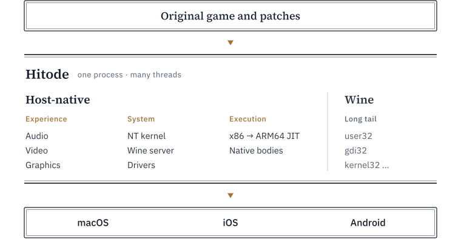

<p align="center">
  
</p>

<h1 align="center">Hitode</h1>

<p align="center">
  Run the original Windows releases of visual novels on Mac, iPhone, iPad and Android.<br>
  English · <a href="README.zh-CN.md">简体中文</a>
</p>

> [!IMPORTANT]
> Hitode is experimental. Only a few engines and games have been adapted and tested so far. It is not ready for everyday play yet: expect crashes, missing features and breaking changes.

How many steps does it take to put an elephant in a fridge? Open the door, put it in, close the door. Hitode wants playing a visual novel on a Mac or a mobile device to take three steps as well: pick the game folder, press Start, play.

No port and no setup: the original exe, its DLLs and translation patches run as they are, with the x86 code executed directly on ARM.

## Features

**One runtime for the common ARM platforms**
- macOS (Apple silicon), iOS / iPadOS and Android share one runtime. Its own x86 → ARM64 JIT translates game code straight into ARM64 machine code with no intermediate representation, so one optimization helps all three platforms.
- Graphics use each platform's native API, Metal on Apple platforms and Vulkan on Android, with power-saving work such as damage-based drawing.

**Compatible with the original games**
- The original exe, DLLs and translation patches run directly. No port is needed, and no particular engine is assumed.
- Hitode does not rebuild all of Windows. It implements the system features visual novels actually use, faithful to how Windows defines them. Fixes go into that shared behavior, so every game adapted helps the next game that needs the same feature.
- Patch-friendly: translation patches often rewrite import tables, function prologues or COM vtables. Every fast path detects such rewrites and falls back to the general path, so the patch still takes effect.
- Text encoding is detected per game (Japanese / Simplified Chinese). Bundled videos, disc images (up to four mounted ISOs) and font substitution work as well.

**Player**

For now Hitode ships a simple player: a launcher that manages the library (with [VNDB](https://vndb.org/) metadata and play time), backs up saves and keeps per-game settings; upscaling filters such as Anime4K and CuNNy; and controls adapted to mobile devices and the Mac.

## Which games run

Hitode does not target particular games or engines. It implements the system features 32-bit Windows visual novels commonly use: GDI, DirectDraw, Direct3D 9, DirectSound, DirectInput, and video through DirectShow, Windows Media and VfW. A game built on these has a chance to run as it is, whether it uses a commercial engine, any version of one, or a brand's in-house engine.

Not supported: 64-bit programs; programs that use Direct3D 10 or later, or OpenGL; programs that only run after bypassing a protector or DRM.

To find out whether your game runs, import it and try. If it will not start, freezes, crashes, stutters or drains the battery, [tell us](https://github.com/hitode-project/hitode/issues/new?template=game-issue.yml) which game and what happened, ideally with the anonymous report the launcher creates. Issues with the same cause are grouped together, and the fix goes into the shared behavior, so one fix helps every similar game. Known problems are in the [issue list](https://github.com/hitode-project/hitode/issues?q=label%3Acompatibility); share the games that play well in [Discussions](https://github.com/hitode-project/hitode/discussions).

## Platforms

| Platform | Status | Notes |
|---|---|---|
| macOS (Apple silicon) | Supported | |
| Android (ARMv8-A, 64-bit) | Supported | |
| iOS / iPadOS | Supported | Not yet tested on iPad or on iOS 26 and later. Needs sideloading; enable JIT with LocalDevVPN or a similar tool, or performance may be too low to play. See [the iOS guide](docs/ios.zh-CN.md) (Chinese) |
| Windows x64 | Debugging only | Not optimized for performance |

## Download

Builds for each platform are on [GitHub Releases](https://github.com/hitode-project/hitode/releases).
<!-- 【待补】mainland China mirror -->

## How it works

Hitode has two parts: a **runtime** that runs Windows programs, and a **player** that hosts it on each platform.

<picture>
  <source media="(prefers-color-scheme: dark)" srcset="docs/images/architecture-dark.svg">
  
</picture>

The approach follows console emulators: the game's own code runs unchanged, and Hitode provides the "hardware" it expects, namely a subset of Windows, graphics, audio and video devices, time and threads.

Windows behavior comes from Wine, built together with the rest of Hitode; its modules run as guest code and cover the long tail. Everything the player feels is host code: audio mixing, MIDI, video decoding, DirectDraw and Direct3D 9, and the timing of all of them. The NT kernel, the Wine server and the drivers run in the same process, so the layers call each other directly. Where a Wine function's bytes are verified unchanged, a native body may run it as host code with the same result.

The runtime also runs without the launcher. `adv-run` is its command-line entry point, for debugging and automated tests.

[ARCHITECTURE.md](ARCHITECTURE.md) maps the code: which layers exist, how they connect and where to look for details. The rules every part must follow are in [docs/spec/](docs/spec/README.md), and switches and options are listed in [docs/configuration.md](docs/configuration.md).

## How it compares

| | Kirikiroid2, ONScripter and similar | Winlator, Wine and similar | Hitode |
|---|---|---|---|
| Games | Specific engines | Most Windows programs | 32-bit visual novel engines |
| Needs a port | Often | No | No |
| Original and translation patches | Depends on the port | Yes | Yes |
| Setup | Easy | Versions and settings often tuned per game | Pick a folder |
| Audio and video | Native in the port | Wine's general-purpose drivers | Native on the host |

Hitode sits between the two: it loads the original program and patches as they are, takes the long tail of Windows behavior from Wine, and runs audio, video and graphics, the parts players feel directly, natively on the host. Every part is built and released together, so a compatibility problem is fixed once, in code, for every game and platform, without per-game settings.

## Building

You need stable Rust and Python 3; the launcher also needs Node.js and pnpm, and video playback needs FFmpeg 8.

```sh
cargo build --release -p adv-run
./target/release/adv-run --help
```

The launcher, builds with media, the player on each platform and macOS packaging are covered in [docs/building.md](docs/building.md). Neither the repository nor any build contains game files.

## Contributing

Feedback and contributions are welcome:

- **Game problems**: use the "game issue" template, naming the game and what happens; the report the launcher saves helps. Search for the game first, and reply there if it is already reported.
- **Player (launcher UI, new features)**: the launcher is still simple, which makes it the easiest place to start. Issues and pull requests are welcome.
- **Runtime: engine and game support**: changes go into the shared Windows behavior, never workarounds for a single game. Each behavior implemented helps every game that uses it, so supporting the next game keeps getting cheaper.
- **Runtime: performance**: optimizations of the CPU, devices and presentation are welcome, with a focus on ARM64.
- **Changes across layers or to a contract** (contracts are in [docs/spec/](docs/spec/README.md)): please open an issue to discuss first.

Read [CONTRIBUTING.md](CONTRIBUTING.md) before you start. Do not commit files, screenshots or traces of commercial games.

## Acknowledgements

Hitode would not exist without these projects.

**Runtime**

- [Wine](https://www.winehq.org/): Windows behavior comes from its modules, which run as guest code, and its server runs inside Hitode. Its source and tests have long been our main reference for how Windows behaves.
- [FreeType](https://freetype.org/): rasterizes the games' text.
- [iced-x86](https://github.com/icedland/iced): the x86 decoder under our CPU.
- [Unicorn](https://www.unicorn-engine.org/) and [QEMU](https://www.qemu.org/): the reference CPUs our tests compare against.
- [SingleStepTests/80386](https://github.com/SingleStepTests/80386): per-instruction test vectors.
- [Berkeley SoftFloat](http://www.jhauser.us/arithmetic/SoftFloat.html): the basis of our x87 floating point.
- Microsoft's [Win32Metadata](https://github.com/microsoft/win32metadata) provides the API signatures; the hook tests use [Detours](https://github.com/microsoft/Detours) and [MinHook](https://github.com/TsudaKageyu/minhook).

**Player**

- [StikDebug](https://github.com/StikDebug/StikDebug) and [idevice](https://github.com/jkcoxson/idevice): JIT on iPhone and iPad without a computer.
- [Moonlight](https://moonlight-stream.org/): the timing of our touch gestures follows its implementation.
- [Magpie](https://github.com/Blinue/Magpie): our upscaling shaders are ported from it; the originals are [Anime4K](https://github.com/bloc97/Anime4K), [CuNNy](https://github.com/funnyplanter/CuNNy), [ArtCNN](https://github.com/Artoriuz/ArtCNN) and k7_modernAnime from [mpv_PlayKit](https://github.com/hooke007/mpv_PlayKit).
- [OxiSynth](https://github.com/PolyMeilex/OxiSynth) and the FluidR3 Mono SoundFont: MIDI music synthesis.
- [FFmpeg](https://ffmpeg.org/) and Xiph's [libtheora](https://www.theora.org/): playback of the games' own videos.

We also use [wgpu](https://wgpu.rs/), [Symphonia](https://github.com/pdeljanov/Symphonia), [cpal](https://github.com/RustAudio/cpal), [encoding_rs](https://github.com/hsivonen/encoding_rs), [corosensei](https://github.com/Amanieu/corosensei), [Tauri](https://tauri.app/) and [Svelte](https://svelte.dev/).

The name comes from the wooden starfish (*hitode*) that Fuko Ibuki carves one by one and gives to everyone in *CLANNAD*. We want to hand these old games, one by one, to more people too.

## Disclaimer

Hitode is an independent project. It is not affiliated with, endorsed by or sponsored by the developers or rights holders of any game engine or game, or any other trademark or copyright owner mentioned here. All trademarks belong to their respective owners.

Hitode contains no game data. Please use copies of games you obtained legally.

## License

Copyright © 2026 [ttyymm233](https://github.com/ttyymm233) and the Hitode contributors.

Hitode is released under the [GNU General Public License, version 3 or any later version](COPYING). Anyone may use, modify and redistribute it, including for a fee, but distributing binaries requires providing the complete corresponding source under the same license.

`crates/adv-unicorn` links Unicorn, which is GPLv2-only and incompatible with GPLv3. It is used only as a test dependency, binaries linking it are not distributed, and `tools/layering/check_layers.py` keeps it out of release builds.

Third-party parts keep their own licenses:

- `crates/adv-cpu-core/softfloat`: Berkeley SoftFloat 3e, BSD-3-Clause.
- `vendor/cpal` (Apache-2.0) and `vendor/symphonia-codec-adpcm` (MPL-2.0): patched upstream code.
- `vendor/libtheora`: the decoder of Xiph libtheora 1.2.0, BSD-3-Clause, with local changes; see its `NOTICE`.
- `vendor/wine`: the server of Wine 11.0 and the headers it includes, the `l_intl.nls` table the server loads at startup, and the `ntsyscalls.h` system call table, LGPL-2.1-or-later, unmodified; see its `NOTICE`.
- `crates/adv-unix/freetype`: the FreeType ftgrays rasterizer, used under the FreeType License (FTL); see its `LICENSE.TXT`.
- `vendor/fluidr3mono`: the FluidR3 Mono GM SoundFont, MIT; see its `LICENSE`.
- `vendor/upscaling`: upscaling shader sources, under GPL-3.0 and each original's license (MIT for Anime4K); see its `NOTICE`.
- `tools/fixtures/vendor/minhook`: a test fixture; see its `LICENSE.txt`.

The Wine modules in release packages are an i386 build of Wine 11.0, LGPL-2.1-or-later; the build scripts are in `tools/wine/`.
