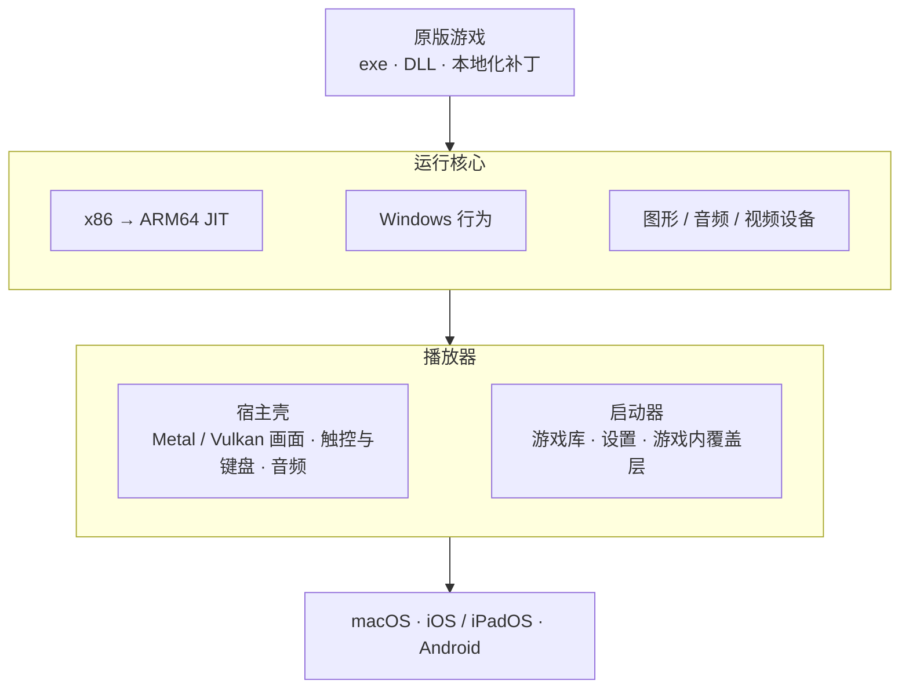

<p align="center">
  
</p>

<h1 align="center">Hitode</h1>

<p align="center">
  在 Mac、iPhone、iPad 和 Android 上直接运行 Windows 版视觉小说的原版程序。<br>
  <a href="README.md">English</a> · 简体中文
</p>

> [!IMPORTANT]
> Hitode 仍处于实验阶段，只在少数引擎和游戏上做过适配与测试。目前不适合日常游玩，可能遇到崩溃、功能缺失和不兼容的改动。

把大象装进冰箱要几步？打开冰箱，放进去，关上。Hitode 想让在 Mac 和移动设备上玩 galgame 也只要三步：选中游戏文件夹，点开始，玩。

不需要移植版，也不需要配置：原版的 exe、DLL 和本地化补丁照常运行，x86 代码直接在 ARM 上执行。

## 特性

**一个运行核心，覆盖常用的 ARM 平台**
- macOS（Apple 芯片）、iOS / iPadOS 和 Android 共用同一个运行核心。自研 x86 → ARM64 JIT 不经过中间表示，直接把游戏代码翻译成 ARM64 机器码；一处优化，三个平台同时受益。
- 图形走各平台的原生后端：Apple 平台用 Metal，Android 用 Vulkan。并做了损伤绘制等针对性的功耗优化处理。

**兼容原版游戏**
- 原版 exe、DLL 和本地化补丁直接运行，不需要移植版，也不绑定某个引擎。
- 不重建整个 Windows，只实现视觉小说实际用到的系统功能，并按 Windows 的定义行为忠实实现。修复都放进通用行为里，每适配一个游戏，后面用到同样功能的游戏都会受益。
- 对补丁友好：本地化补丁常常改写导入表、函数开头或 COM 虚表。所有加速路径都会检测这类改写，发现后回到通用路径，补丁照常生效。
- 文字编码按游戏自动识别（日文 / 简体中文），游戏自带的视频、光盘镜像（最多挂载 4 个 ISO）和字体替换都能正常使用。

**播放器**

目前我们提供一个简易的播放器：一个启动器管理游戏库（关联 [VNDB](https://vndb.org/) 信息、记录游玩时间）、备份存档和按游戏调整设置；画面可以用 Anime4K、CuNNy 等超分滤镜放大；适配移动设备和 Mac 的操作。

## 能玩哪些游戏

Hitode 不针对某个游戏或引擎做适配，而是实现 32 位 Windows 视觉小说常用的系统功能：GDI、DirectDraw、Direct3D 9、DirectSound、DirectInput，以及 DirectShow、Windows Media 和 VfW 视频。只要游戏建立在这些功能之上，不论是商业引擎、引擎的哪个版本，还是品牌自研的引擎，都有机会直接运行。

不支持：64 位程序；使用 Direct3D 10 及以上或 OpenGL 的程序；需要绕过保护壳或 DRM 才能运行的程序。

想知道自己的游戏能不能玩，直接导入试试就好。进不去、卡死、闪退、卡顿或者耗电异常，欢迎[告诉我们](https://github.com/hitode-project/hitode/issues/new?template=game-issue.yml)哪款游戏、出了什么问题，附上启动器生成的匿名报告更好。我们会把同一原因的问题归到一起，修复放进通用行为，一处修好，同类游戏都会受益。已知问题见 [issue 列表](https://github.com/hitode-project/hitode/issues?q=label%3Acompatibility)；能玩的游戏欢迎到 [Discussions](https://github.com/hitode-project/hitode/discussions) 分享。

## 支持的平台

| 平台 | 状态 | 说明 |
|---|---|---|
| macOS（Apple 芯片） | 支持 | |
| Android（ARMv8-A，64 位） | 支持 | |
| iOS / iPadOS | 支持 | iPad 和 iOS 26 以上系统尚未实机测试。需自签安装；请用 LocalDevVPN 等工具启用 JIT，否则性能可能不足以游玩。安装方法见 [iOS 教程](docs/ios.zh-CN.md) |
| Windows x64 | 仅供调试 | 不做性能优化 |

## 下载

各平台的安装包见 [GitHub Releases](https://github.com/hitode-project/hitode/releases)。
<!-- 【待补】国内镜像 -->

## 工作原理

Hitode 分为两部分：一个运行 Windows 程序的**运行时核心**，以及在各平台上承载它的**播放器**。



思路借鉴主机模拟器：游戏自己的代码原样运行，Hitode 只提供它期待的“硬件”，也就是 Windows 的一个子集、图形音频视频设备、时间和线程。

核心也可以脱离启动器单独运行，`adv-run` 是它的命令行入口，便于调试和自动化测试。

[ARCHITECTURE.md](ARCHITECTURE.md) 是代码地图：有哪些层、怎么连接、细节去哪里看。各部分必须遵守的规则在 [docs/spec/](docs/spec/README.md)，开关和选项列在 [docs/configuration.md](docs/configuration.md)。

## 和其他方案的区别

| | Kirikiroid2、ONScripter 等 | Winlator、Wine 等 | Hitode |
|---|---|---|---|
| 支持的游戏 | 特定引擎 | 大多数 Windows 程序 | 32 位视觉小说引擎 |
| 需要移植版 | 往往需要 | 不需要 | 不需要 |
| 原版补丁 | 视移植情况 | 可以 | 可以 |
| 上手配置 | 简单 | 较繁琐 | 选文件夹即可 |
| 体积 | 小 | 较大 | 小 |

Hitode 想在两者之间找一个平衡点：照常加载原版程序和补丁，但只实现视觉小说用得上的部分，把精力集中在游玩体验和引擎兼容上。

## 构建

需要 Rust stable 和 Python 3；启动器另需 Node.js 和 pnpm，视频播放需要 FFmpeg 8。

```sh
cargo build --release -p adv-run
./target/release/adv-run --help
```

启动器、带媒体的构建、各平台播放器和 macOS 打包见 [docs/building.md](docs/building.md)（英文）。仓库和任何构建都不包含游戏文件。

## 参与开发

欢迎反馈和贡献：

- **游戏问题**：用 issue 里的“游戏问题”模板，写明哪款游戏、什么现象；能附上启动器保存的报告更好。提交前先搜一下游戏名，已有就在那里回复。
- **播放器（启动器界面、新功能）**：启动器目前还很简易，这是门槛最低的入口，欢迎直接提 issue 或 PR。
- **核心：引擎和游戏适配**：修改放进通用的 Windows 行为里，不针对单个游戏绕过。每实现一项行为，所有用到它的游戏都会受益，适配下一个游戏的成本会越来越低。
- **核心：性能调优**：欢迎 CPU、设备和画面呈现方面的优化，重点是 ARM64。
- **跨层或改变契约的改动**（契约见 [docs/spec/](docs/spec/README.md)）：请先开 issue 讨论。

动手前请先读 [CONTRIBUTING.md](CONTRIBUTING.md)。请勿提交商业游戏的文件、截图或 trace。

## 致谢

没有这些项目就没有 Hitode。

**运行核心**

- [Wine](https://www.winehq.org/)：它的源码和测试是我们了解 Windows 行为的主要参考，它的服务端在 Hitode 内运行。
- [iced-x86](https://github.com/icedland/iced)：我们 CPU 底下的 x86 解码器。
- [Unicorn](https://www.unicorn-engine.org/) 和 [QEMU](https://www.qemu.org/)：测试用来对照的参考 CPU。
- [SingleStepTests/80386](https://github.com/SingleStepTests/80386)：逐条指令的测试向量。
- [Berkeley SoftFloat](http://www.jhauser.us/arithmetic/SoftFloat.html)：我们 x87 浮点的基础。
- 微软的 [Win32Metadata](https://github.com/microsoft/win32metadata) 提供 API 签名；hook 测试用到了 [Detours](https://github.com/microsoft/Detours) 和 [MinHook](https://github.com/TsudaKageyu/minhook)。

**各平台的播放器**

- [StikDebug](https://github.com/StikDebug/StikDebug) 和 [idevice](https://github.com/jkcoxson/idevice)：让 iPhone 和 iPad 不借助电脑也能开启 JIT。
- [Moonlight](https://moonlight-stream.org/)：触控手势的时序参照它的实现。
- [Magpie](https://github.com/Blinue/Magpie)：超分着色器移植自它，原作是 [Anime4K](https://github.com/bloc97/Anime4K)、[CuNNy](https://github.com/funnyplanter/CuNNy)、[ArtCNN](https://github.com/Artoriuz/ArtCNN) 和 [mpv_PlayKit](https://github.com/hooke007/mpv_PlayKit) 的 k7_modernAnime。
- [FFmpeg](https://ffmpeg.org/) 和 Xiph 的 [libtheora](https://www.theora.org/)：播放游戏自带的视频。

我们还用到了 [wgpu](https://wgpu.rs/)、[Symphonia](https://github.com/pdeljanov/Symphonia)、[cpal](https://github.com/RustAudio/cpal)、[encoding_rs](https://github.com/hsivonen/encoding_rs)、[Tauri](https://tauri.app/) 和 [Svelte](https://svelte.dev/)。

名字取自《CLANNAD》里伊吹风子一个个亲手雕、送给大家的木海星（ヒトデ）。我们也想把这些老游戏，一份份送到更多人手里。

## 声明

Hitode 是独立项目，与任何游戏引擎或游戏的开发者、权利方，以及本文提到的其他商标或版权所有者均无关联，也未获得其认可或赞助。所有商标归各自所有者所有。

Hitode 不包含任何游戏数据，请使用您合法取得的游戏副本。

## 许可证

Copyright © 2026 [ttyymm233](https://github.com/ttyymm233) 与 Hitode 贡献者。

Hitode 以 [GNU 通用公共许可证第 3 版或任何更新版本](COPYING)发布。任何人都可以使用、修改和再分发，包括收费分发；但分发二进制时必须同时以同一许可证提供完整的对应源码。

`crates/adv-unicorn` 链接了 GPLv2-only 的 Unicorn，与 GPLv3 不兼容。它只作为测试依赖使用，链接了它的二进制不对外分发；`tools/layering/check_layers.py` 保证它不进入发行构建。

第三方部分保留各自的许可证：

- `crates/adv-cpu-core/softfloat`：Berkeley SoftFloat 3e，BSD-3-Clause。
- `vendor/cpal`（Apache-2.0）和 `vendor/symphonia-codec-adpcm`（MPL-2.0）：打过补丁的上游代码。
- `vendor/libtheora`：Xiph libtheora 1.2.0 解码部分，BSD-3-Clause，有本地修改，见其 `NOTICE`。
- `vendor/wine`：Wine 11.0 的服务端及其包含的头文件，LGPL-2.1-or-later，未修改，见其 `NOTICE`。
- `vendor/upscaling`：超分着色器源码，GPL-3.0 与各原作的许可证（Anime4K 为 MIT），见其 `NOTICE`。
- `tools/fixtures/vendor/minhook`：测试夹具，见其 `LICENSE.txt`。
