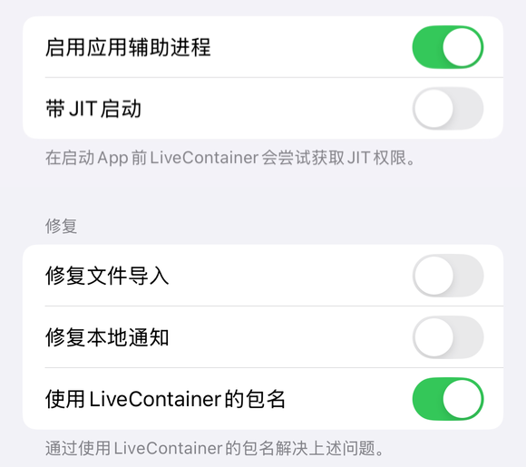
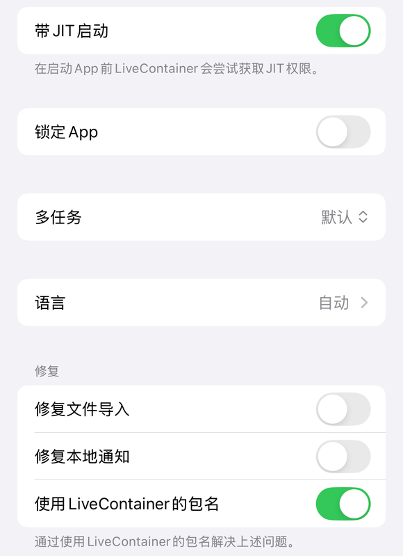
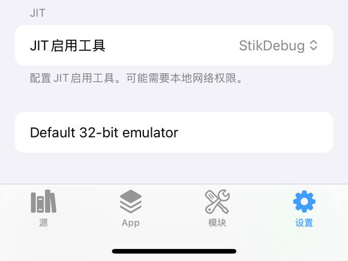
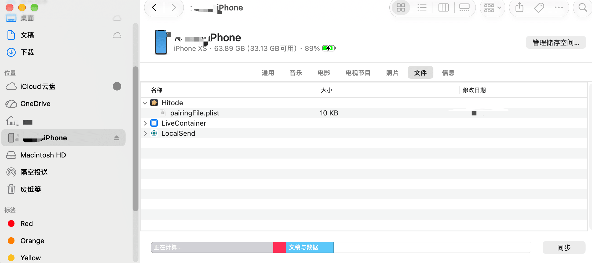
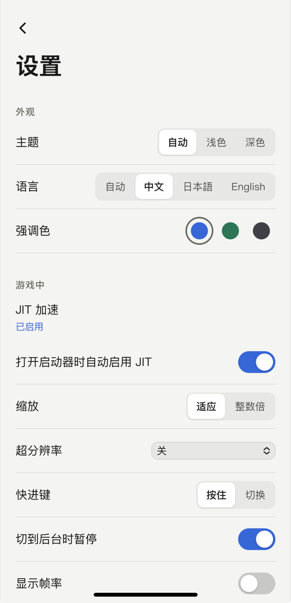
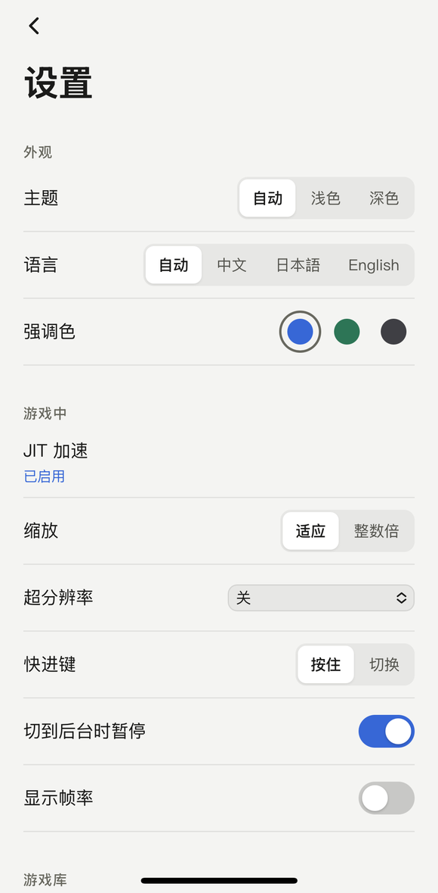

# 在 iPhone 和 iPad 上安装 Hitode

读完这篇，你可以在 iPhone 或 iPad 上安装 Hitode，开启 JIT 加速，并导入自己的游戏。

## 支持的设备

最低系统版本为 iOS / iPadOS 16.2，芯片要求 A12 或更新。

## iOS / iPadOS 16.2 至 17.3.1

这一段系统需要从外部工具启用 JIT。设置页的「JIT 加速」显示「已启用」后，再启动游戏。

| 系统 | 开启 JIT |
|---|---|
| 16.2–16.6.1、16.7 RC（20H18）、17.0 | 已装 [TrollStore 2.0.12 或更新版本](https://github.com/opa334/TrollStore/releases/tag/2.0.12) 的设备：导入 Hitode 的 TrollStore 包，在 TrollStore 的应用列表中点按 Hitode，选择 **Open with JIT**。每次彻底退出 Hitode 后都要这样启动。 |
| 16.x 其余版本 | 用开发签名安装，按 [SideStore JIT 指南](https://docs.sidestore.io/docs/advanced/jit/) 配对后，在 SideStore 里选择 **Enable JIT**。 |
| 17.0.1–17.3.1 | 用开发签名安装，由电脑上的 [SideJITServer](https://github.com/nythepegasus/SideJITServer) 启用 JIT。也可以通过 [LiveContainer](https://livecontainer.github.io/docs/guides/jit-support/) 调用该服务。 |

如果[发布页](https://github.com/hitode-project/hitode/releases/latest)提供 `Hitode-<版本号>-ios-trollstore.ipa`，下载这个包。也可以按[构建文档](building.md#ios-launcher)在本地构建。该路径无需给 Hitode 导入配对文件，也无需 LocalDevVPN。

## 安装（iOS / iPadOS 17.4 及以上）

下文的自签流程需要一台电脑（Mac 或 Windows）、一个 Apple ID 和一根数据线（只在首次连接时用）。第一次大约需要 20 分钟，之后每周花约 1 分钟续签。

> **必须用开发签名安装。**
> 用免费 Apple ID 自签（下述方法）或用付费开发者账号自签均可。ad-hoc、企业签、"超级签"、TestFlight 等分发签名能安装，但无法开启 JIT，游戏无法正常游玩。

为什么必须用开发签名？

JIT 需要调试器临时附加到 Hitode 上。在这条自签安装路径中，由开发签名提供这个权限（`get-task-allow`）。各种分发签名都没有此权限。第三方签名服务基本都是分发签名，企业证书有被随时吊销的风险，笔者不建议使用。

### 选择安装方式

三种方式都先用电脑上的 iloader 装好 LiveContainer + SideStore，开启 JIT 的原理也一样，区别在 Hitode 装在哪里、由谁开启 JIT。

**一般选方式一**：只占 1 个 app 名额，不占 App ID，打开 Hitode 就自动开启 JIT。方式一用不了时，再选方式二或方式三。

| | 方式一（推荐）：装进 LiveContainer，Hitode 自己开启 JIT | 方式二：装进 LiveContainer，用 StikDebug 开启 JIT | 方式三：Hitode 直接安装 |
|---|---|---|---|
| 占用的 app 名额（免费账号共 3 个） | 1 个：LiveContainer + SideStore | 2 个：LiveContainer + SideStore、StikDebug | 2 个：LiveContainer + SideStore、Hitode |
| 另外占用的 App ID（每 7 天最多 10 个） | 不占 | 1 个：StikDebug（Hitode 不占） | 2 个：Hitode 本体和 JIT 扩展 |
| 开启 JIT | 打开 Hitode 时自动开启 | 从 LiveContainer 启动 Hitode 时，由 StikDebug 自动开启 | 打开 Hitode 时自动开启 |
| 配对文件放在 | Hitode | StikDebug | Hitode |
| 续签 | SideStore 续签 LiveContainer，Hitode 不用单独续签 | SideStore 续签 LiveContainer 和 StikDebug，Hitode 不用单独续签 | SideStore 续签 Hitode |
| 要求 | 在 iloader 里安装“LiveContainer + SideStore（每夜构建版）”，需要 2026-11-08 的构建（LiveContainer 3.8.13，提交 9d6ea09b）及以后 | | |

### 安装步骤

1. **在手机上下载 Hitode 的 IPA 安装包**，保存到"文件"app 里。
   在 [最新版本的发布页](https://github.com/hitode-project/hitode/releases/latest) 下载 `Hitode-<版本号>-ios-unsigned.ipa`。选方式二的话，再从 [StikDebug 的发布页](https://github.com/StikDebug/StikDebug/releases/latest) 下载它的 IPA。
2. **在电脑上安装 iloader。** 下载和使用方法见 [iloader 的说明页](https://github.com/nab138/iloader)。
3. **用数据线连接手机，在 iloader 里登录 Apple ID。**
   手机上会弹出"要信任此电脑吗？"，选择"信任"。信任只能通过数据线完成；之后只要手机和电脑连着同一个 Wi-Fi，下文用到 iloader 的步骤都可以无线进行，iloader 会自动识别设备。
4. **用 iloader 安装 LiveContainer + SideStore**，完成后桌面上会出现 LiveContainer 的图标。
   方式一选“LiveContainer + SideStore（每夜构建版）”，它带有 Hitode 自己开启 JIT 所需的“启用应用辅助进程”。iloader 每次装的都是最新的每夜构建；这项功能从 2026-11-08 的构建（LiveContainer 3.8.13，提交 [9d6ea09b](https://github.com/LiveContainer/LiveContainer/commit/9d6ea09b05afa2c8fc537c372795a294db631311)）开始提供，之前装过的旧每夜构建版要重新安装一次。方式二、方式三选“LiveContainer + SideStore（稳定版）”即可。
5. **打开开发者模式。**
   到 设置 → 隐私与安全性 → 开发者模式，打开开关，然后按提示重启手机。不打开的话，自签的 app 都无法启动。详见 [Apple 的说明](https://developer.apple.com/documentation/xcode/enabling-developer-mode-on-a-device)。
6. **信任开发者。**
   第一次打开 LiveContainer 时如果提示"不受信任的开发者"，就到 设置 → 通用 → VPN 与设备管理 里，信任你的 Apple ID。之后用同一个 Apple ID 安装的 app 不用再信任。详见 [Apple 的说明](https://support.apple.com/zh-cn/118254)。
7. **安装 Hitode**，按你选的方式：
   - **方式一**：在 LiveContainer 里点"+"，选中第 1 步下载的 Hitode IPA。装好后长按 Hitode → 设置，打开"启用应用辅助进程"，"带JIT启动"保持关闭，再在"修复"一栏打开"使用 LiveContainer 的包名"。不需要安装 StikDebug。

     
   - **方式二**：在 LiveContainer 里点"+"，选中第 1 步下载的 Hitode IPA。装好后长按 Hitode → 设置，打开"带JIT启动"，并在"修复"一栏打开"使用 LiveContainer 的包名"。然后打开 SideStore，登录同一个 Apple ID，在"My Apps"里点"+"，选中 StikDebug 的 IPA。装好后回到 LiveContainer，在底部的"设置"页把"JIT启用工具"选为"StikDebug"。

     

     
   - **方式三**：打开 SideStore，登录同一个 Apple ID，在"My Apps"里点"+"，选中 Hitode 的 IPA。完成后，桌面上会出现 Hitode 的图标。

   SideStore 的具体操作见 [SideStore 文档](https://docs.sidestore.io/)。方式二、方式三要通过 SideStore 安装一次，因为 SideStore 只能续签经它安装的 app。
   由于近期 Apple 改变了认证方式，各类第三方安装服务受到了不同程度的影响，如果 SideStore 暂时登录不上，可以先用 iloader 的"导入 IPA"安装（IPA 要下载到电脑上），之后用 iloader 续签；等 SideStore 能登录了，再在 SideStore 里安装一次，交给它续签。

免费 Apple ID 有哪些限制？

- 签名 7 天后过期，过期前需要续签（见"每次游玩"）。
- 同时最多装 3 个自签 app，每 7 天最多注册 10 个 App ID。
- 直接安装的 Hitode 自带一个 JIT 扩展，扩展需要额外占用 App ID，共计占用 2 个 App ID，但只算 1 个 app 名额。装进 LiveContainer 的 Hitode 不占用 App ID 和名额。

## 一次性设置

这一节只需要做一次。

### 1. 安装 LocalDevVPN

从 App Store 安装 [LocalDevVPN](https://apps.apple.com/app/localdevvpn/id6755608044)，打开它并连接。

LocalDevVPN 只在手机内部建一条本地通道，不会把你的流量发到外部服务器，开着它也能正常上网。该 App 未在中国大陆区的 App Store 上架，请自备一个非中国大陆区的 Apple ID 用于下载或自签安装。

### 2. 放好配对文件

开启 JIT 需要一个配对文件 `pairingFile.plist`，这个文件要用 iloader 在你自己的电脑上生成。

**方式一、方式三**：把配对文件放进 Hitode。

1. 在 iloader 里选择“管理配对文件”导出配对文件，保存为 `pairingFile.plist`。
2. 把它传到手机上，下面任选一种方法。方式一的 Hitode 装在 LiveContainer 里，"访达"和 Apple Devices 里看不到它，请用局域网的方法。
   - **数据线（Mac，方式三）**：打开"访达"，在侧边栏选中你的 iPhone，进入"文件"标签页，把 `pairingFile.plist` 拖到 Hitode 上。详见 [Apple 的说明](https://support.apple.com/zh-cn/119585)。这种方法传完就直接放好了，不用再导入。
   - **数据线（Windows，方式三）**：用 Apple Devices 或 iTunes 的文件共享。
   - **局域网**：用 [LocalSend](https://localsend.org/) 从电脑发到手机。Mac 用户也可以用隔空投送。然后在 Hitode 设置里点"导入配对文件"，到"文件"app 里选中刚收到的文件。导入完成后，把收到的那份删掉。
3. 打开 Hitode 的设置页，看到"配对文件已导入"就说明成功了。

如果手机上已经有配对文件（比如 iloader 给 StikDebug 放过一份），也可以在 Hitode 设置里点"导入配对文件"，到"文件"app 里选中它。

**方式二**：在 iloader 里选择"管理配对文件"，把配对文件放进 StikDebug。Hitode 不需要配对文件。

> **配对文件要像密码一样保管。**
> 拿到这个文件的人，就能像你信任过的电脑一样访问你的手机，比如安装或删除 app、读取 app 里的数据。
> - 只在自己的电脑上生成，不要用别人发来的，也不要用网上的"在线生成"服务。
> - 只在自己的设备之间直接传输：数据线、信任的私有 Wi-Fi 下的 LocalSend 或隔空投送都可以。不要在公共 Wi-Fi 下传输，接收时确认发送方是你自己的电脑。
> - 不要通过 SNS 软件或网盘发送给其他人，提交反馈时也不要附上它。
> - 不要把 Hitode 的整个文件夹分享给别人，配对文件就在里面。
> - 如果怀疑泄露了：到 设置 → 通用 → 传输或还原 iPhone → 还原 → 还原位置与隐私，这会清除所有受信任的电脑，已有的配对文件全部失效，重新信任后也不会恢复。然后插线重新信任电脑，用 iloader 生成新的配对文件，重新放进 Hitode 和 SideStore。注意这也会重置所有 app 的位置、照片等权限。

### 3. 开启 JIT

**方式一、方式三**：

1. 确认 LocalDevVPN 已经连接。
2. 打开 Hitode（方式一从 LiveContainer 里打开），在设置页的"JIT 加速"里点"启用 JIT"。
   第一次开启时，Hitode 会自动下载开发者镜像（约 16 MB），然后依次显示连接设备、挂载镜像、准备 JIT 代码池等进度。iOS 27 每次重启都会换一个配对端口，重启后第一次开启时可能多显示几秒“正在查找设备的配对端口…”。
3. 进度结束后，设置页的“JIT 加速”显示“已启用”。游戏库顶部的 JIT 提示可点“不再提醒”永久关闭，同时关闭启动游戏前的 JIT 警告。

以后每次打开 Hitode，只要 LocalDevVPN 开着，JIT 都会自动开启（"打开启动器时自动启用 JIT"默认打开）。

**方式二**：

1. 确认 LocalDevVPN 已经连接。
2. 在 LiveContainer 里启动 Hitode。LiveContainer 会先打开 StikDebug 开启 JIT，再打开 Hitode。StikDebug 第一次使用时会自己下载开发者镜像。
3. Hitode 设置页的"JIT 加速"显示"已启用"。以后每次从 LiveContainer 启动 Hitode，都会这样自动开启。

## 每次游玩

1. 打开 LocalDevVPN 并确认已连接。
2. 打开 Hitode，等 JIT 开启后再进游戏。方式一、方式二要从 LiveContainer 启动 Hitode。
   JIT 开启之前就启动的游戏，这一整局都会以解释模式运行，速度慢很多。
3. 玩完之后可以关掉 LocalDevVPN，恢复你平时用的 VPN。iOS 同时只能开一个 VPN。

### 每 7 天续签一次

免费 Apple ID 签的 app 7 天后过期，过期后就无法打开。建议每隔几天手动续签或搭配快捷指令自动化续签：

- **平时**：打开 SideStore 刷新。方式一刷新 LiveContainer，方式二刷新 LiveContainer 和 StikDebug，方式三刷新 Hitode。具体操作见 [SideStore 文档](https://docs.sidestore.io/)。
- **SideStore 登录失败或已经过期时**：用电脑上的 iloader 重新安装一次。

续签和重新安装时，**请一直使用同一个 Apple ID**。这样新安装的 app 会直接覆盖旧的，游戏和存档都会保留。方式一、方式二更新 Hitode 时，在 LiveContainer 里重新导入新版 IPA 即可。

换了 Apple ID 会怎么样？（方式三）

签名工具会把 Apple ID 对应的开发者编号加到 app 的标识里，所以换一个 Apple ID 签名，系统会把它当成另一个 app：

- 桌面上会多出一个新的 Hitode，里面是空的。旧的 Hitode 还在，但到期后就打不开了。
- 写在游戏文件夹里的存档跟着游戏走，不受影响。写在 C 盘的存档留在旧 Hitode 里，换之前先在"文件"app 里把旧 Hitode 文件夹里的"C"文件夹复制到新 Hitode 的文件夹里。游戏设置等写在注册表里的内容不会带过去。
- 游戏放在 Hitode 文件夹之外的话（推荐的做法），在新 Hitode 里重新"添加游戏文件夹"即可。
- 配对文件只和设备有关，换 Apple ID 后照样能用，把它从旧 Hitode 的文件夹移到新 Hitode 的文件夹里就行。

## 导入游戏

Hitode 直接在原来的位置读取游戏文件夹，不会复制一份。

在 LiveContainer 中使用时，请先返回 LiveContainer，长按 Hitode → 设置，打开“使用 LiveContainer 的包名”，再重新启动 Hitode。导入确认页仅在首次导入时显示这条提示；未开启时，可能在“文件”里选好文件夹、点“打开”后没有反应。

> **把游戏放在 Hitode 文件夹之外。**
> 建议在"文件"app 的"我的 iPhone"下新建一个文件夹（比如"Games"），专门存放游戏。放在 Hitode 自己的文件夹里的游戏，会在删除 Hitode 时被一起删掉，换 Apple ID 重新安装时也要手动搬家。

1. 用任意你喜欢的方式把游戏文件夹传到手机上，再在"文件"app 里移到你建的游戏文件夹

2. 在 Hitode 里点"添加游戏文件夹"，在"文件"里选中**整个游戏文件夹**，不要只选里面的程序。

存档分两种，取决于游戏把它写在哪里：

- **写在游戏文件夹里**：Hitode 直接写回原来的游戏文件夹。游戏放在 Hitode 文件夹之外时，删除 Hitode 也不会丢。
- **写在 C 盘**（比如"我的文档"、AppData 等 Windows 用户目录）：放在 Hitode 文件夹里的"C"文件夹中，**删除 Hitode 时会一起消失**。在游戏的管理菜单或游戏设置里点"打开 C 盘"可以看到它，删除 Hitode 之前请把里面的存档复制到别处保存。

游戏设置等写在注册表里的内容保存在 Hitode 的私有数据里，删除 Hitode 时同样会消失。

## 常见问题

下面的小标题就是 Hitode 里显示的提示文字。

### 当前签名不支持 JIT

你装的是分发签名的 Hitode，比如 ad-hoc、企业签或 TestFlight。请删掉它，按"安装"一节用开发签名重新安装。注意写在 C 盘的存档会一起删除，删除前先按"导入游戏"一节把它们复制出来。

### 连不上 LocalDevVPN，请确认它已开启并显示已连接

打开 LocalDevVPN，确认状态是已连接，再回到 Hitode 重试。如果你同时开着别的 VPN，LocalDevVPN 会被挤掉。

### 设备上找不到配对服务，请确认已开启开发者模式，重新连接 LocalDevVPN 后再试

LocalDevVPN 是通的，但手机上没有应答的配对服务。确认 设置 → 隐私与安全性 → 开发者模式 已打开，在 LocalDevVPN 里断开再连接，然后回到 Hitode 重试。仍然不行就重启手机。

### 这台设备不接受当前的配对文件，请用 iloader 重新生成 pairingFile.plist 并重新导入

这份配对文件已经失效，或者不是这台设备的，比如还原过位置与隐私，或者放错了别的设备的文件。请按"一次性设置"第 2 步，用 iloader 为这台设备重新生成 `pairingFile.plist`，再导入 Hitode。

### LiveContainer 无法启动 Hitode 的 JIT 扩展

LiveContainer 版本太旧，或者没有打开"启用应用辅助进程"。请按"安装"第 4 步，在 iloader 里重新安装“LiveContainer + SideStore（每夜构建版）”，然后长按 Hitode → 设置，打开"启用应用辅助进程"，再重新启动 Hitode。也可以按方式二改用 StikDebug 开启 JIT。

### 这是 SideStore 等使用的旧格式配对文件，请选择 StikDebug 使用的 pairingFile.plist

你选中的是 SideStore 用的另一种配对文件。请按"一次性设置"第 2 步，用 iloader 导出 `pairingFile.plist`。

### 这不是配对文件，请选择 StikDebug 使用的 pairingFile.plist

你选中的文件不是配对文件，请重新选择。

### SideStore 登录失败或续签出错

比如提示 "Failed to Sign In"、-80045、"数据格式错误"。这是 SideStore 和 Apple 认证之间的问题，和 Hitode 无关。

- 先改用电脑上的 iloader 安装或续签 Hitode，见"安装"第 7 步的备用办法。
- SideStore 本身的问题和修复进展，请看 [SideStore 文档](https://docs.sidestore.io/) 和它的 [GitHub issues](https://github.com/SideStore/SideStore/issues)。

### 游戏能运行但很卡

在设置页确认“JIT 加速”是否显示“已启用”，未启用时按“一次性设置”第 3 步操作。还要注意：JIT 开启之前就启动的游戏，要退出后重新启动才会用上 JIT。

## 参考链接

- [iloader](https://github.com/nab138/iloader)：电脑端安装工具，也用来生成配对文件。
- [SideStore 文档](https://docs.sidestore.io/)：手机端续签工具。
- [LiveContainer](https://github.com/LiveContainer/LiveContainer)：不占 App ID 运行自签 app 的容器。
- [StikDebug](https://github.com/StikDebug/StikDebug)：方式二用来开启 JIT。
- [LocalDevVPN](https://github.com/jkcoxson/LocalDevVPN)：开启 JIT 所需的本地 VPN。
- [LocalSend](https://localsend.org/)：局域网传文件，用来传配对文件和游戏。
- [Apple：信任开发者](https://support.apple.com/zh-cn/118254)
- [Apple：打开开发者模式](https://developer.apple.com/documentation/xcode/enabling-developer-mode-on-a-device)
- [Apple：使用"访达"共享文件](https://support.apple.com/zh-cn/119585)
