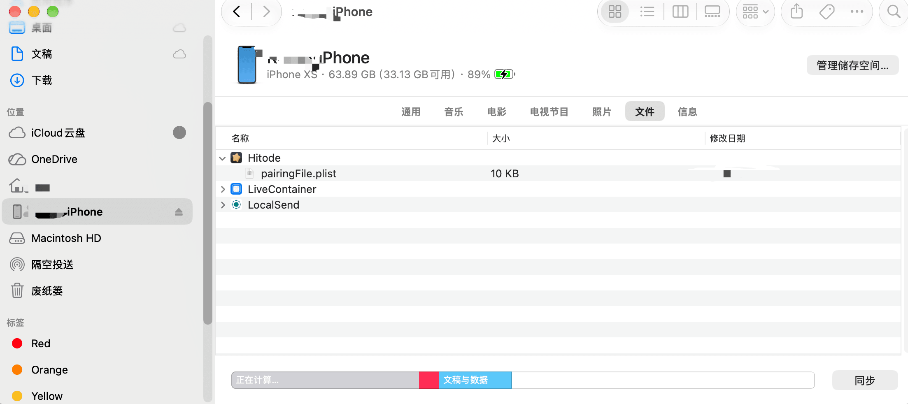
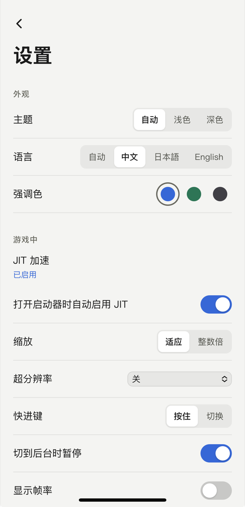

# 在 iPhone 和 iPad 上安装 Hitode

读完这篇，你可以在 iPhone 或 iPad 上安装 Hitode，开启 JIT 加速，并导入自己的游戏。

- **你需要准备**：一台电脑（Mac 或 Windows）、一个 Apple ID、一根数据线（只在第一次连接时用）。
- **大约要花多久**：第一次大约 20 分钟；之后每周花 1 分钟续签。
- **最后验证**：2026-10-19，iPhone XS / iOS 18.7。

## 支持的设备

- 需要 iOS / iPadOS 18 或更新的版本。
- 已实机验证：iPhone XS（iOS 18.7）。
- iPad 和 iOS 26 以上的系统还没有实机测试，欢迎反馈。

## 安装

> **必须用开发签名安装。**
> 用免费 Apple ID 自签（下述方法）或用付费开发者账号自签均可。ad-hoc、企业签、"超级签"、TestFlight 等分发签名能安装，但无法开启 JIT，游戏无法正常游玩。

为什么必须用开发签名？

JIT 需要调试器临时附加到 Hitode 上，而只有开发签名才带这个权限（`get-task-allow`）。各种分发签名都没有此权限。第三方签名服务基本都是分发签名，企业证书有被随时吊销的风险，笔者不建议使用。

我们推荐的组合是：**用电脑上的 iloader 装好 SideStore，再用 SideStore 安装和续签 Hitode。** SideStore 只能续签经它安装的 app，所以 Hitode 要通过 SideStore 安装一次。

1. **在手机上下载 Hitode 的 IPA 安装包**，保存到"文件"app 里。
   在 [最新版本的发布页](https://github.com/hitode-project/hitode/releases/latest) 下载 `Hitode-<版本号>-ios-unsigned.ipa`。
2. **在电脑上安装 iloader。** 下载和使用方法见 [iloader 的说明页](https://github.com/nab138/iloader)。
3. **用数据线连接手机，在 iloader 里登录 Apple ID。**
   手机上会弹出"要信任此电脑吗？"，选择"信任"。信任只能通过数据线完成；之后只要手机和电脑连着同一个 Wi-Fi，下文用到 iloader 的步骤都可以无线进行，iloader 会自动识别设备。
4. **用 iloader 安装 SideStore**，完成后桌面上会出现 SideStore 的图标。
5. **打开开发者模式。**
   到 设置 → 隐私与安全性 → 开发者模式，打开开关，然后按提示重启手机。不打开的话，SideStore 和 Hitode 都无法启动。详见 [Apple 的说明](https://developer.apple.com/documentation/xcode/enabling-developer-mode-on-a-device)。
6. **信任开发者。**
   第一次打开 SideStore 时如果提示"不受信任的开发者"，就到 设置 → 通用 → VPN 与设备管理 里，信任你的 Apple ID。之后用同一个 Apple ID 安装的 app 不用再信任。详见 [Apple 的说明](https://support.apple.com/zh-cn/118254)。
7. **在 SideStore 里安装 Hitode。**
   打开 SideStore，登录同一个 Apple ID，在"My Apps"里点"+"，选中第 1 步下载的 IPA。具体操作见 [SideStore 文档](https://docs.sidestore.io/)。
   完成后，桌面上会出现 Hitode 的图标。
   由于近期 Apple 改变了认证方式，各类第三方安装服务受到了不同程度的影响，如果 SideStore 暂时登录不上，可以先用 iloader 的"导入 IPA"安装 Hitode（IPA 要下载到电脑上），之后用 iloader 续签；等 SideStore 能登录了，再按这一步在 SideStore 里安装一次，交给它续签。

免费 Apple ID 有哪些限制？

- 签名 7 天后过期，过期前需要续签（见"每次游玩"）。
- 同时最多装 3 个自签 app，每 7 天最多注册 10 个 App ID。
- Hitode 自带一个 JIT 扩展，扩展需要额外占用 App ID，共计占用 2 个 App ID。

## 一次性设置

这一节只需要做一次，做完之后 Hitode 就能自动开启 JIT。

### 1. 安装 LocalDevVPN

从 App Store 安装 [LocalDevVPN](https://apps.apple.com/app/localdevvpn/id6755608044)，打开它并连接。

LocalDevVPN 只在手机内部建一条本地通道，不会把你的流量发到外部服务器，开着它也能正常上网。该 App 未在中国大陆区的 App Store 上架，请自备一个非中国大陆区的 Apple ID 用于下载或自签安装。

### 2. 把配对文件放进 Hitode

开启 JIT 需要一个配对文件 `pairingFile.plist`，这个文件要用 iloader 在你自己的电脑上生成。

1. 在 iloader 里选择“管理配对文件”导出配对文件，保存为 `pairingFile.plist`。
2. 把它传到手机上，下面任选一种方法：
   - **数据线（Mac）**：打开"访达"，在侧边栏选中你的 iPhone，进入"文件"标签页，把 `pairingFile.plist` 拖到 Hitode 上。详见 [Apple 的说明](https://support.apple.com/zh-cn/119585)。这种方法传完就直接放好了，不用再导入。
   - **数据线（Windows）**：用 Apple Devices 或 iTunes 的文件共享。
   - **局域网**：用 [LocalSend](https://localsend.org/) 从电脑发到手机。Mac 用户也可以用隔空投送。然后在 Hitode 设置里点"导入配对文件"，到"文件"app 里选中刚收到的文件。导入完成后，把收到的那份删掉。
3. 打开 Hitode 的设置页，看到"配对文件已导入"就说明成功了。

如果手机上已经有配对文件（比如 iloader 给 StikDebug 放过一份），也可以在 Hitode 设置里点"导入配对文件"，到"文件"app 里选中它。

> **配对文件要像密码一样保管。**
> 拿到这个文件的人，就能像你信任过的电脑一样访问你的手机，比如安装或删除 app、读取 app 里的数据。
> - 只在自己的电脑上生成，不要用别人发来的，也不要用网上的"在线生成"服务。
> - 只在自己的设备之间直接传输：数据线、信任的私有 Wi-Fi 下的 LocalSend 或隔空投送都可以。不要在公共 Wi-Fi 下传输，接收时确认发送方是你自己的电脑。
> - 不要通过 SNS 软件或网盘发送给其他人，提交反馈时也不要附上它。
> - 不要把 Hitode 的整个文件夹分享给别人，配对文件就在里面。
> - 如果怀疑泄露了：到 设置 → 通用 → 传输或还原 iPhone → 还原 → 还原位置与隐私，这会清除所有受信任的电脑，已有的配对文件全部失效，重新信任后也不会恢复。然后插线重新信任电脑，用 iloader 生成新的配对文件，重新放进 Hitode 和 SideStore。注意这也会重置所有 app 的位置、照片等权限。

### 3. 开启 JIT

1. 确认 LocalDevVPN 已经连接。
2. 打开 Hitode，在设置页的"JIT 加速"里点"启用 JIT"。
   第一次开启时，Hitode 会自动下载开发者镜像（约 16 MB），然后依次显示连接设备、挂载镜像、准备 JIT 代码池等进度。
3. 进度结束后，游戏库顶部的"强烈建议启用 JIT"提示就会消失。

以后每次打开 Hitode，只要 LocalDevVPN 开着，JIT 都会自动开启（"打开启动器时自动启用 JIT"默认打开）。

## 每次游玩

1. 打开 LocalDevVPN 并确认已连接。
2. 打开 Hitode，等 JIT 开启后再进游戏。
   JIT 开启之前就启动的游戏，这一整局都会以解释模式运行，速度慢很多。
3. 玩完之后可以关掉 LocalDevVPN，恢复你平时用的 VPN。iOS 同时只能开一个 VPN。

### 每 7 天续签一次

免费 Apple ID 签的 app 7 天后过期，过期后就无法打开。建议每隔几天手动续签或搭配快捷指令自动化续签：

- **平时**：打开 SideStore 刷新 Hitode。具体操作见 [SideStore 文档](https://docs.sidestore.io/)。
- **SideStore 登录失败或已经过期时**：用电脑上的 iloader 重新安装一次 Hitode。

续签和重新安装时，**请一直使用同一个 Apple ID**。这样新安装的 Hitode 会直接覆盖旧的，游戏和存档都会保留。

换了 Apple ID 会怎么样？

签名工具会把 Apple ID 对应的开发者编号加到 app 的标识里，所以换一个 Apple ID 签名，系统会把它当成另一个 app：

- 桌面上会多出一个新的 Hitode，里面是空的。旧的 Hitode 还在，但到期后就打不开了。
- 旧 Hitode 里的存档不会自动带过去。换 Apple ID 之前，先趁旧 Hitode 还能打开，用"导出到文件夹…"备份存档，再到新 Hitode 里导入。
- 游戏放在 Hitode 文件夹之外的话（推荐的做法），在新 Hitode 里重新"添加游戏文件夹"即可。
- 配对文件只和设备有关，换 Apple ID 后照样能用，把它从旧 Hitode 的文件夹移到新 Hitode 的文件夹里就行。

## 导入游戏

Hitode 直接在原来的位置读取游戏文件夹，不会复制一份。

> **把游戏放在 Hitode 文件夹之外。**
> 建议在"文件"app 的"我的 iPhone"下新建一个文件夹（比如"Games"），专门存放游戏。放在 Hitode 自己的文件夹里的游戏，会在删除 Hitode 时被一起删掉，换 Apple ID 重新安装时也要手动搬家。

1. 用任意你喜欢的方式把游戏文件夹传到手机上，再在"文件"app 里移到你建的游戏文件夹

2. 在 Hitode 里点"添加游戏文件夹"，在"文件"里选中**整个游戏文件夹**，不要只选里面的程序。

存档和设置保存在 Hitode 自己的数据目录里，和游戏文件夹分开。删除 Hitode 时，游戏还在，但存档会被一起删除，删除前请先用"导出到文件夹…"备份。

## 常见问题

下面的小标题就是 Hitode 里显示的提示文字。

### 当前签名不支持 JIT

你装的是分发签名的 Hitode，比如 ad-hoc、企业签或 TestFlight。请删掉它，按"安装"一节用开发签名重新安装。删除前先备份存档。

### 连不上 LocalDevVPN，请确认它已开启并显示已连接

打开 LocalDevVPN，确认状态是已连接，再回到 Hitode 重试。如果你同时开着别的 VPN，LocalDevVPN 会被挤掉。

### 这是 SideStore 等使用的旧格式配对文件，请选择 StikDebug 使用的 pairingFile.plist

你选中的是 SideStore 用的另一种配对文件。请按"一次性设置"第 2 步，用 iloader 导出 `pairingFile.plist`。

### 这不是配对文件，请选择 StikDebug 使用的 pairingFile.plist

你选中的文件不是配对文件，请重新选择。

### SideStore 登录失败或续签出错

比如提示 "Failed to Sign In"、-80045、"数据格式错误"。这是 SideStore 和 Apple 认证之间的问题，和 Hitode 无关。

- 先改用电脑上的 iloader 安装或续签 Hitode，见"安装"第 7 步的备用办法。
- SideStore 本身的问题和修复进展，请看 [SideStore 文档](https://docs.sidestore.io/) 和它的 [GitHub issues](https://github.com/SideStore/SideStore/issues)。

### 游戏能运行但很卡

先看游戏库顶部有没有"强烈建议启用 JIT"的提示。有的话，说明 JIT 还没开启，按"一次性设置"第 3 步操作。还要注意：JIT 开启之前就启动的游戏，要退出后重新启动才会用上 JIT。

## 参考链接

- [iloader](https://github.com/nab138/iloader)：电脑端安装工具，也用来生成配对文件。
- [SideStore 文档](https://docs.sidestore.io/)：手机端续签工具。
- [LocalDevVPN](https://github.com/jkcoxson/LocalDevVPN)：开启 JIT 所需的本地 VPN。
- [LocalSend](https://localsend.org/)：局域网传文件，用来传配对文件和游戏。
- [Apple：信任开发者](https://support.apple.com/zh-cn/118254)
- [Apple：打开开发者模式](https://developer.apple.com/documentation/xcode/enabling-developer-mode-on-a-device)
- [Apple：使用"访达"共享文件](https://support.apple.com/zh-cn/119585)
